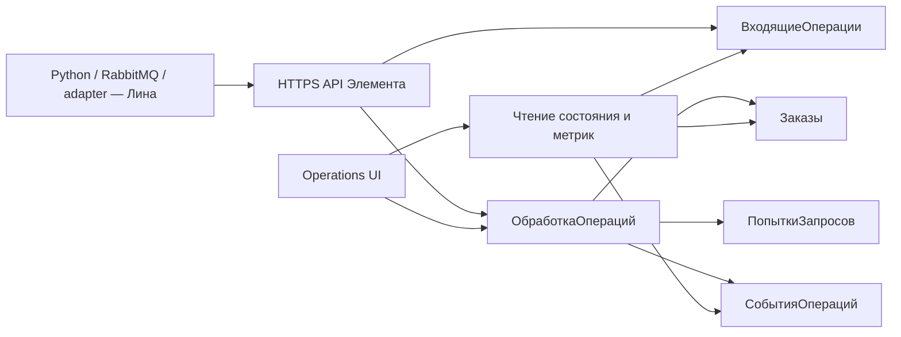

# ReliabilityLab: проект части Элемента

Дата: 17 ноября 2026. Статус: целевая архитектура; первый серверный срез C реализован, скомпилирован и проверен на dev-приложении. Текущие ограничения — FIRST_SLICE.md. Владелец — Лёша. Контракт предстоит согласовать с Линой.

## 1. Границы и основание решений

Сохраняем проект `alexkey/ReliabilityLab/`, поставщика, существующие UUID, совместимость 10.0 и подсистему `Основное`. Исходный каркас расширен серверной моделью и API C.

Элемент отвечает за устойчивый inbox, создание настоящего заказа, журнал, чтение состояния, экспериментальные режимы и интерфейс. Генератор, RabbitMQ, HTTP-адаптер и runner — часть Лины. Код Элемента не подключается к брокеру напрямую. На первом этапе нет фоновой обработки, outbox и дополнительных сервисов.

Решения ниже — наш проект на основе прочитанной документации, а не обещания платформы о готовом механизме exactly-once. Ссылки и пределы проверки — в [ELEMENT_RESEARCH.md](ELEMENT_RESEARCH.md).

## 2. Модель хранения

Логические имена API — английские, имена метаданных — русские. Все регистры ниже независимые и непериодические. Время события — поле, а не часть ключа, если это явно не указано.

| Метаданные | Вид и ключ | Поля / назначение |
|---|---|---|
| Прогоны | Регистр сведений; RunId | Strategy A/B/C, Scenario, Seed, DatasetId, FaultPlanId, ExpectedCount, BaselineEnabled, CreatedAt, ProtocolVersion, конфигурация тайм-аутов/повторов и версии компонентов |
| ВходящиеОперации | Регистр сведений; OperationId | RunId, OrderId, AmountMinor, Currency, CreatedAt клиента, ReceivedAt сервера, каноническое бизнес-содержимое, состояние, CanonicalOrder (ссылка на Заказы), CompletedAt, сохранённый бизнес-результат C |
| Заказы | Документ; системная ссылка, Дата, Номер | OperationId, RunId, ExternalOrderId, AmountMinor, Currency, CreatedByAttemptId, CreatedAt сервера |
| ПопыткиЗапросов | Регистр сведений; AttemptId | OperationId, RunId, HTTP-метод/ресурс, содержимое команды, StartedAt, FinishedAt, STARTED/SUCCEEDED/FAILED/REPLAYED, Order (ссылка), ErrorCode, сохранённый ответ |
| СобытияОпераций | Регистр сведений; EventId | OperationId, RunId, AttemptId, Source, EventType, OccurredAt, RecordedAt, детали без секретов |

Перечисления: СтратегииВосстановления, СценарииСбоев, СостоянияОпераций, ИсходыПопыток, ТипыСобытий. DTO — отдельные структуры для сообщений, команд, ответов и ошибок. Их точные XBSL-типы создаются на этапе реализации по документации.

OperationId глобально уникален в приложении. Для сравнительных прогонов разные OperationId, но одинаковые логические заказы, суммы, seed и план сбоев. RunId операции неизменяем. Время сервера — UTC; клиентское время хранится отдельно, не подменяет серверное.

ExternalOrderId и OperationId **не получают уникальный индекс в Заказы**: иначе учебный baseline A не сможет показать повторный бизнес-эффект. Системный Номер документа уникален, каждый эффект получает отдельную ссылку. Защита C обеспечивается общей записью операции, блокировкой и транзакцией. Автоматическая нумерация не является ключом идемпотентности.

Состояние, результат и ссылка на заказ — ресурсы/реквизиты регистра, не дополнительные измерения. Включение AttemptId в ключ ВходящиеОперации разрушило бы дедупликацию между попытками.

Индексы для чтения: операции по RunId; заказы по RunId/OperationId; попытки и события по OperationId/RunId. Не сохраняем изменяемые KPI-счётчики: сначала считаем агрегаты по таблицам.

## 3. Приём сообщения

1. Проверить доступ, DTO, существование прогона и его конфигурацию.
2. В основной транзакции установить исключительную блокировку ключа OperationId **до чтения**, включая случай отсутствующей записи.
3. Если записи нет — сохранить бизнес-содержимое, RECEIVED, попытку приёма и событие PERSISTED.
4. Если запись есть и содержимое совпадает — вернуть существующее состояние; не перезаписывать результат и исходное время получения.
5. Если содержимое отличается — вернуть 409 OPERATION_PAYLOAD_CONFLICT без изменения заказа/операции.
6. Вернуть успешный ответ только после завершения основной транзакции.

Канонизация v1: сравнивать нормализованные типизированные поля schema_version, operation_id, run_id, order_id, amount_minor, currency, created_at. Порядок JSON-полей и пробелы значения не меняют. AttemptId, токен и режим сбоя не входят в бизнес-содержимое. Криптографический hash не обязателен для MVP.

## 4. Выполнение стратегии C

Отдельный синхронный POST запускает выполнение; POST приёма сам заказ не создаёт.

**T1 — регистрация попытки:** короткая основная транзакция создаёт STARTED. Повтор того же AttemptId с другой командой — конфликт. Завершённая попытка возвращает сохранённый результат; STARTED — ATTEMPT_IN_PROGRESS. Новый HTTP-повтор использует новый AttemptId.

**T2 — бизнес-транзакция:**

1. Начать основную транзакцию, взять исключительную блокировку ключа операции, затем ключа попытки; повторно прочитать данные под блокировкой.
2. Если CanonicalOrder уже записан — сохранить исход попытки REPLAYED, вернуть тот же бизнес-результат, новый заказ не создавать.
3. Иначе создать Заказы; в той же транзакции записать CanonicalOrder, COMPLETED, CompletedAt, результат попытки и BUSINESS_COMMITTED в журнал.
4. Завершить основную транзакцию. Только затем сериализовать и отправить HTTP-ответ.

**Ошибка до commit:** исключение выходит из T2, все её изменения откатываются. В новой короткой транзакции регистрируем подтверждённую ошибку попытки; COMPLETED не затираем. Если и журналирование ошибки недоступно, остаётся STARTED — это допустимый след неполной попытки.

Все конкурирующие пути записи C используют тот же ключ и порядок блокировок. Конфликт/тайм-аут блокировки приводит к ограниченному повтору клиентом с новым AttemptId, а не к обходу защиты. Прямое создание заказов пользователем исключаем из экспериментального пути; формы заказов для демонстрации — на чтение. Административное вмешательство и запись в обход сервиса не входят в гарантию C.

**Восстановление незавершённой попытки:** новый запрос C снова берёт блокировку операции и читает устойчивый результат. Активный старый обработчик удерживает эту же блокировку; завершившийся без commit не оставляет бизнес-эффекта. Старый STARTED сам по себе не разрешает объявить FAILED и не блокирует операцию навсегда. Отдельная система lease/фоновых заданий для этого MVP не нужна.

Не ловить ошибку внутри транзакционной области так, чтобы выход стал нормальным и случайно зафиксировал изменения. Не считать фиксацию вложенной транзакции окончательным commit. На входе в методы, владеющие фиксацией, проверять отсутствие внешней активной транзакции. UI и HTTP вызывают эти методы вне своей транзакции. HTTP-вызовы, задержки и отправка ответа находятся вне T2.

Гарантия C после проверок: не более одного заказа на OperationId при записи через этот протокол, в пределах проверенного приложения и общей БД. Это не гарантия end-to-end exactly-once доставки.

## 5. A и B: сравнимые учебные режимы

Прогон имеет неизменную Strategy. Для A/B дополнительно требуется BaselineEnabled; переключать существующую операцию из C в A нельзя.

- A и B используют один намеренно неидемпотентный обработчик: каждая **новая** попытка обработки создаёт отдельный заказ, даже если предыдущая уже создала эффект. Сохранение заказа и результата конкретной попытки остаётся транзакционным.
- A при потере ответа повторяет обработку без чтения состояния.
- B сначала читает состояние; при обнаруженном заказе повтор не нужен. Если исходный обработчик ещё не завершён, проверка может увидеть отсутствие эффекта, после чего новый вызов создаст дубль. Это проверяемая гонка, не гарантия безопасности.
- C использует ту же бизнес-операцию создания заказа с дополнительной защитой по OperationId.
- Повтор того же AttemptId не создаёт новую бизнес-попытку во всех трёх режимах. Реальная повторная HTTP-попытка адаптера всегда получает новый ID; это условие явно входит в протокол эксперимента.

Не обнулять агрегат COMPLETED, если более поздняя попытка A/B завершилась ошибкой. Состояние отдельной попытки и факт наличия хотя бы одного заказа — разные поля.

## 6. Состояния и сбои

| Факт | Сервер / наблюдатель |
|---|---|
| Сообщение устойчиво принято, заказа нет | RECEIVED |
| Попытка запущена, исход ещё не записан | PROCESSING как состояние попытки; не доказательство активного процесса |
| Заказ и результат зафиксированы | COMPLETED |
| Известен откат попытки, нет заказа | FAILED для попытки; операция допускает повтор |
| Клиент не получил достоверного исхода | UNKNOWN у клиента; серверный заказ может уже существовать |

`fail_before_commit`: детерминированное исключение в T2 после подготовки/записи заказа, до завершения транзакции; проверяем полный откат. Срабатывает один раз на выбранную операцию; отметка о назначении сбоя фиксируется до T2, чтобы откат не вызывал бесконечный сбой. Известное ограничение: авария между отметкой и T2 может израсходовать назначенный сбой; такой прогон помечаем непригодным для основного сравнения.

`drop_response_after_commit`: основной воспроизводимый вариант — адаптер получает успешный ответ и намеренно отбрасывает его до своей классификации результата. Это моделирование потери ответа. Фактический разрыв соединения со стороны Элемента не обещаем: документация об обработчике не подтверждает такой прикладной API. Клиент пишет RESPONSE_DISCARDED и UNKNOWN в свой журнал; сервер хранит BUSINESS_COMMITTED. Исключение после commit с полученным HTTP 500 — отдельный сценарий ошибки ответа, не сетевой тайм-аут.

`duplicate_delivery`: повтор исходного бизнес-сообщения с тем же OperationId, но новым AttemptId. Для проверки гонки B — контролируемая задержка вне T2 и барьер во внешнем runner; одинаковый план задержек для сравниваемых стратегий. Это последующий интеграционный этап Лины.

План сбоев привязан к RunId и OperationId, а не к глобальному переключателю приложения. Изменение плана после начала прогона запрещено.

## 7. ACK и границы ответственности

Выбранная точка ACK для первого MVP: подтверждённое создание заказа или восстановленный результат, содержащий ссылку на уже зафиксированный заказ. Приём inbox сам по себе ACK не разрешает. Это проектное решение для согласования с Линой.

При тайм-ауте исход UNKNOWN; для C адаптер читает состояние/повторяет безопасно. После исчерпания повторов сообщение должно оставаться учтённым как unresolved/переданным в ограниченную очередь ошибок по протоколу Лины, а не исчезать из-за автоматического ACK или бесконечно переотправляться.

## 8. Модули и порядок реализации

- `ReliabilityLabApi` — HttpСервис, маршрутизация, DTO, коды ответа.
- `ОбработкаОпераций` — серверный общий модуль: приём, транзакции, стратегии.
- `ЧтениеОпераций` — серверные методы состояния, журнала и агрегатов.
- `Operations` — форма приложения; `OperationDetails` — подробности; `RunComparison` — сравнение запусков.
- Бизнес-методы не зависят от HTTP и UI, но сами владеют своими основными транзакциями.

Этап 1: регистры, документ, DTO, приём/обработка C/чтение и штатная авторизация. Этап 2: проверки commit/rollback и конкуренции C. Этап 3: baseline A/B и сбои. Этап 4: UI и импорт наблюдений клиента. Этап 5: интеграция с Линой, реальные серии и графики.

## 9. Интерфейс и метрики

Operations: выбор прогона, KPI, таблица, фильтр статуса, панель деталей с событиями. Метрики сервера: Received — число уникальных операций; Completed — число операций с заказом; Duplicate Business Effects — сумма max(0, число заказов операции − 1); Duplicate Attempts — число попыток обработки сверх первой для каждой операции, без GET и приёма сообщения.

Sent, Unknown и время восстановления требуют наблюдений клиента. До их загрузки показываем `N/A`, не нули. События клиента сохраняются с Source=ADAPTER, EventId и исходным временем; они не изменяют заказы и серверный COMPLETED. Повтор импорта EventId безопасен, другой payload того же EventId — конфликт. Клиентские сообщения — заявленные наблюдения, не серверное доказательство эффекта.

Timeline показывает источник события. Между часами клиента и сервера не вычисляем точные длительности без синхронизации; задержки runner измеряет монотонными часами. Основные показатели p50/p95 и сравнение A/B/C рассчитываются из сохранённых реальных прогонов с одинаковыми DatasetId и FaultPlanId. Демо-кнопки активны только при подключённом исполнителе; локальный вызов из UI маркируется как Element-only, не RabbitMQ demo.

## 10. Что обязательно проверить в реализации

Блокировка отсутствующего ключа, параллельный приём, rollback заказа вместе с результатом, отсутствие внешней транзакции, конкуренция C, повтор после остановки обработчика, конфликт payload, штатный токен опубликованного приложения, точный URL публикации, чтение состояния при активной обработке. До этих проверок проект не называется доказанно корректным. Полная матрица — [TEST_PLAN.md](TEST_PLAN.md).
