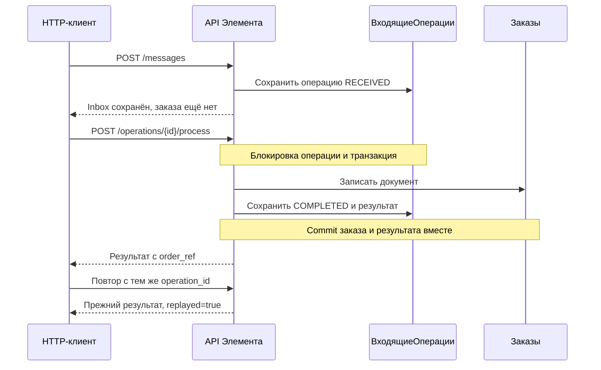

# Лёша, начни отсюда: как устроен ReliabilityLab

Это руководство по твоей части проекта на 1С:Элементе. Оно описывает текущую реализацию, а не весь будущий MVP. Дата: 17 ноября 2026.

## Что мы исследуем

Представь интернет-магазин. Клиент просит создать заказ. Сервер сохраняет заказ, но ответ теряется в сети. Клиент видит тайм-аут и отправляет запрос ещё раз. Если сервер каждый раз создаёт новый заказ, одна покупка превращается в две.

ReliabilityLab позволяет проверить восстановление после таких ситуаций. Главный вопрос: «Можно ли повторить запрос и получить прежний результат, сохранив один бизнес-эффект?» Бизнес-эффект в нашем приложении — настоящий сохранённый документ «Заказы».

Сейчас реализована стратегия C: устойчивая запись операции, блокировка на время обработки и совместная фиксация заказа с результатом. Стратегии A/B для сравнения ещё предстоит добавить. Текущие проверки C не доказывают exactly-once для всей будущей системы.

## Почему здесь регистры

В Элементе регистр сведений — способ хранить структурированные записи. Здесь это не бухгалтерский учёт и не движения денег. У записи есть **измерения** (ключ, по которому её отличают от других) и **ресурсы** (хранимые значения).

Например, у «ВходящихОпераций» единственное измерение — ИдОперации. Поэтому разные HTTP-попытки одной операции обращаются к одной записи. Если сделать попытку частью ключа, каждый повтор стал бы отдельной операцией и защита от повторов потеряла бы смысл.

| Объект | Простыми словами | Ключ | Зачем нужен |
|---|---|---|---|
| Прогоны | Папка одного эксперимента | ИдПрогона | Хранит выбранную стратегию и настройки сбоя; объединяет сравнимые операции |
| ВходящиеОперации | Принятая задача и её итог | ИдОперации | Помнит бизнес-содержимое, состояние и канонический результат между запросами |
| Заказы | Реальный результат работы | Системная ссылка документа | Позволяет независимо посчитать созданные заказы и обнаружить дубли |
| ПопыткиЗапросов | Журнал отдельных обращений | ИдПопытки | Различает повторные вызовы, их начало, завершение и сохранённые ответы |
| СобытияОпераций | История того, что произошло | ИдСобытия | Помогает восстановить последовательность приёма, обработки, сбоя и повтора |

Операция, попытка и событие — разные сущности. Одна операция может иметь несколько попыток; одна попытка — несколько событий. При стратегии C повторные попытки должны ссылаться на тот же результат.

## Четыре идентификатора на примере

Пусть run_id = `lesha_demo_01`, operation_id = `lesha_demo_01_op1`, order_id = `ORD_001`.

- **run_id** — весь эксперимент. В нём может быть тысяча операций.
- **operation_id** — одно намерение создать конкретный заказ. При повторе его сохраняем.
- **order_id** — внешний бизнес-номер заказа. Это не системная ссылка документа Элемента.
- **attempt_id** — UUID v4 одного обращения. Для нового HTTP-повтора создаём новый UUID.

Системная ссылка `order_ref` появляется после записи настоящего документа. При безопасном повторе C она остаётся прежней. Один operation_id с другой суммой или другим бизнес-содержимым отклоняется как конфликт, а не превращается в новый заказ.

## Как сообщение превращается в заказ

Приём и обработка разделены специально: «сообщение сохранено» и «заказ создан» — разные достигнутые этапы. Простое получение HTTP 2xx тоже не описывает весь путь сообщения через RabbitMQ.

Сервис использует короткую первую транзакцию для записи начала попытки и назначения тестового сбоя. В следующей транзакции под блокировкой операции создаёт заказ и сохраняет итог. Конкурирующие обработчики одной операции не должны одновременно создавать заказы C.

## Как понимать состояния

| Значение | Что можно заключить |
|---|---|
| RECEIVED | Входящее сообщение сохранено; заказ этим фактом не подтверждён |
| COMPLETED | Сервер зафиксировал заказ и канонический результат |
| STARTED у попытки | Попытка началась; одного этого недостаточно, чтобы назвать её неуспешной |
| REPLAYED у попытки / replayed=true | Возвращён уже существующий результат |
| UNKNOWN у клиента | Клиент не знает исхода. Заказ мог сохраниться; нужно прочитать серверное состояние |
| OUTCOME_UNCONFIRMED | Обработчик не смог достоверно подтвердить исход; сверяем фактические данные |

Состояние операции и исход попытки не обязаны совпадать. Например, операция уже COMPLETED, а новая попытка только получает сохранённый результат. Не исправляй состояния вручную в регистрах: они связаны с заказами, сохранёнными ответами и событиями.

## Как пользоваться новым интерфейсом

Открой [dev-приложение](https://app-802542381.1cmycloud.com/applications/Reliability-lab-dev). После загрузки новой версии интерфейса в навигации доступны:

| Раздел | Что смотреть |
|---|---|
| Overview | Карта приложения, пояснения и переходы в разделы |
| Operations | Принятые операции: состояние, сумма, ссылка на заказ, сохранённый результат |
| Orders | Реальные документы — проверка фактических бизнес-эффектов |
| Runs | Стратегия и конфигурация каждого эксперимента |
| Attempts | Отдельные вызовы: UUID, команда, время, исход и HTTP-код |
| Events | События сервера: тип, время, операция и попытка |

Подписи интерфейса английские по соглашению проекта, имена метаданных и код русские. Списки читают настоящие данные приложения; макетов заказов и демонстрационных KPI нет. Используй фильтр Operation ID для одной операции, Run ID — для эксперимента; обновляй список после новых вызовов. Суммы пока показаны в копейках: 150000 = 1500 рублей.

Начни с Operations → выбери Operation ID → найди его в Orders → затем в Attempts и Events. Одинаковый ID связывает все эти представления. В таблицах уже могут быть синтетические данные приёмочных проверок с run_id, начинающимися на `check_`.

Это первая версия интерфейса наблюдения: здесь нет формы запуска эксперимента, кнопки Retry, графиков или общей карточки операции. Новые операции пока создаются через API. В будущем такие действия будут вызывать тот же серверный алгоритм, а не записывать документы в обход него.

## Два полезных сценария для понимания

**Обычная обработка и повтор.** Создать прогон C → принять сообщение → проверить RECEIVED и отсутствие заказа → вызвать process → увидеть COMPLETED и один заказ → повторить process с новым attempt_id → проверить прежний order_ref и по-прежнему один заказ. В Attempts станет больше записей, количество заказов не увеличится.

**Сбой до commit.** Создать прогон с `fail_before_commit` → принять сообщение → первая обработка намеренно вызывает исключение после записи документа, но до фиксации транзакции → документ откатывается → повтор с новым attempt_id создаёт один заказ. Сбой назначается один раз, чтобы следующий повтор мог восстановиться. Не путай этот тест с аварийным завершением процесса: такое завершение ещё не проверялось.

При потере ответа после commit клиент сначала читает GET операции. Если заказ уже есть, отсутствие ответа не превращает его в отсутствующий заказ. В приёмочных проверках потеря ответа моделировалась отбрасыванием полученного ответа клиентом; реальный обрыв сети этим не доказан.

Точные JSON и коды ошибок смотри в [FIRST_SLICE.md](FIRST_SLICE.md); текущие исполняемые сценарии — в [test_element_api.py](../tests/test_element_api.py).

## Где искать код

| Файл или папка | Назначение |
|---|---|
| `alexkey/ReliabilityLab/Основное/` | Весь текущий проектный код и метаданные |
| `ReliabilityLabApi.yaml` и `.xbsl` | HTTP-маршруты и тонкий слой обработки запросов |
| `КонтрактApi.xbsl` | Проверка полей, идентификаторов, сумм и форматов |
| `ОбработкаОпераций.xbsl` | Приём, блокировки, транзакции, создание заказа и восстановление |
| YAML регистров и Заказы.yaml | Схема хранения данных |
| `Приложение.yaml`, `ГлавнаяСтраница.*`, `*ФормаСписка.yaml` | Навигация, главная страница и таблицы |
| `experiments/acceptance/` | Сохранённые результаты реальных проверок |
| `docs/CONTRACT.md` | Будущий расширенный контракт; некоторые маршруты ещё не реализованы |

Для чтения кода начни с HTTP-маршрута и проследи вызов в модуль обработки. YAML отвечает на вопрос «что хранится/показывается», XBSL — «какой алгоритм выполняется».

## Что готово и что осталось

Серверный срез C скомпилирован на 10.0.7-28; 15 live-проверок прошли на сборке 1.0-5, включая конкуренцию и откат до commit. Это прямые HTTP-проверки Элемента. RabbitMQ, генератор и адаптер Лины в них не участвовали.

Новая навигация и списки добавляются поверх этого среза. Их статус компиляции фиксируется отдельно в SETUP.md: наличие YAML в Git само по себе не доказывает, что интерфейс опубликован и визуально проверен.

Дальше: единая карточка операции с историей и безопасным Retry; запуск демонстрации из UI; стратегии A/B; настоящие метрики по прогонам; интеграция с Линой. Сейчас нулевые или случайные числа на графиках вводили бы в заблуждение, поэтому графиков пока нет.

## Как изменения попадают в облако

Правка файлов → локальная проверка → commit → push в GitHub → получение изменений в IDE → компиляция и публикация → проверка приложения. Pull исходников сам по себе не означает обновление запущенного приложения.

При публикации через Console API можно загрузить архив исходников вместо сборки из IDE. Это отдельный путь: он не делает push или pull автоматически. Перед такой публикацией исходники должны быть сохранены в Git, а после — проверены задача обновления и точная версия приложения.

Пароли, cookies, `.env`, `.netrc` и локальные инструменты авторизации в репозиторий не входят. Для приложения нужен пользователь с разрешённым доступом; текущий серверный срез ограничен администраторами.
